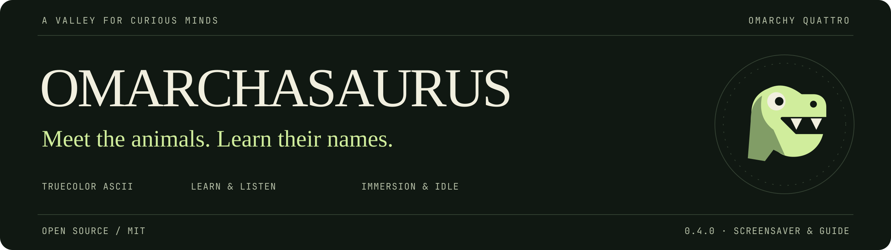
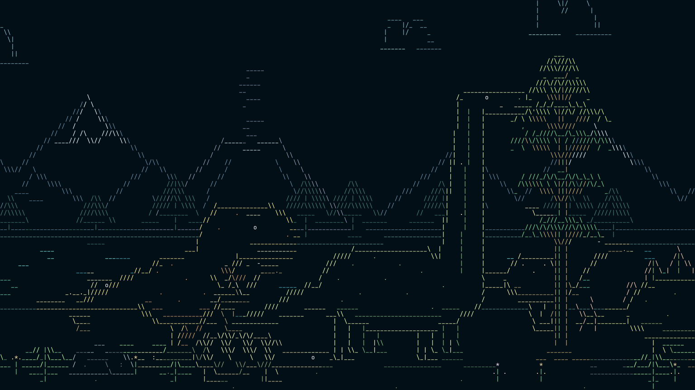

<p align="center">
  <a href="https://daileng.github.io/Omarchasaurus/">
    
  </a>
</p>

<h1 align="center">A prehistoric valley. A real terminal.</h1>

<p align="center">
  A kid-friendly, interactive ASCII dinosaur valley for <strong>Omarchy Quattro</strong>.<br>
  Learn the names. Hear them spoken. Find out what fossils can tell us.
</p>

<p align="center">
  <a href="https://daileng.github.io/Omarchasaurus/#field-guide"><strong>Explore &amp; Hear Names</strong></a>
  &nbsp; / &nbsp;
  <a href="#install">Get Started</a>
  &nbsp; / &nbsp;
  <a href="#controls">Controls</a>
  &nbsp; / &nbsp;
  <a href="#documentation">Docs</a>
</p>

<p align="center">
  <a href="LICENSE"><kbd>MIT</kbd></a>
  &nbsp; <kbd>Python 3.11+</kbd>
  &nbsp; <kbd>Omarchy Quattro</kbd>
  &nbsp; <kbd>Development preview · 0.3.0</kbd>
</p>



<p align="center"><sub>Actual production World/Canvas snapshot, rendered to PNG. No image protocol or separate GPU scene.</sub></p>

**A development preview, not a finished screensaver service.** Manual **Enter Immersion** and screensaver-style **Start** are available. Automatic idle activation and in-screensaver sound are **off and not implemented**; the website's spoken names are a separate learning feature. Marketplace submission/approval is separate from this repository; no marketplace verification is claimed.

## In the valley

| Field notes | What is here |
| --- | --- |
| **Character, not pixels** | An always-present Brachiosaurus among mountains, a volcano, tall trees, a lake, a nest and clouds—all drawn with ordinary terminal characters. |
| **Room for company** | T. rex, Triceratops, Stegosaurus, Ankylosaurus, Parasaurolophus and Diplodocus, plus the marine reptile Plesiosaurus and the pterosaur Pteranodon. Arrivals respect the animal ceiling. |
| **Small encounters** | Hover to discover an animal's name, then click for articulated reactions, a sky meteor or a lake leap. Rare hatching, flock, shower, rainbow and volcano events unfold over active session time. |
| **Your composition** | Morning and Dusk palettes; independent scenery, animal and crowding choices; reduced motion. Randomize stages a valley for review—it never autosaves. |
| **An intentional pause** | Launch manually on the focused output or Start on every active output. Surface stops only the plugin's owned sessions. |

## Young explorers: start here

**[Open the free field guide](https://daileng.github.io/Omarchasaurus/#field-guide)** to meet all nine animals, hear their names and follow museum links. You do **not** need Linux or an installation to read and listen on the website. Ask a grown-up to help with the terminal installation below.

| Animal | How to spot it | Explore |
| --- | --- | --- |
| **Brachiosaurus** | High shoulders, long front legs and a long neck for reaching plants. | [Read and hear its name](https://daileng.github.io/Omarchasaurus/#brachiosaurus) |
| **Tyrannosaurus rex** | A big-headed meat-eater with two small fingers on each hand. “T. rex” is its short name. | [Read and hear its name](https://daileng.github.io/Omarchasaurus/#tyrannosaurus-rex) |
| **Triceratops** | Three horns and a broad bony frill behind its head; it ate plants. | [Read and hear its name](https://daileng.github.io/Omarchasaurus/#triceratops) |
| **Stegosaurus** | Plates along its back and spikes on its tail. | [Read and hear its name](https://daileng.github.io/Omarchasaurus/#stegosaurus) |
| **Ankylosaurus** | Bony armor over its body and a heavy club at the tail's end. | [Read and hear its name](https://daileng.github.io/Omarchasaurus/#ankylosaurus) |
| **Parasaurolophus** | A hollow, backward-pointing head crest; scientists think it helped with calls and display. | [Read and hear its name](https://daileng.github.io/Omarchasaurus/#parasaurolophus) |
| **Diplodocus** | A long, low plant-eater with a very long, whip-like tail. | [Read and hear its name](https://daileng.github.io/Omarchasaurus/#diplodocus) |
| **Plesiosaurus** | A marine reptile with four flippers—not a dinosaur. Real Plesiosaurus swam in the sea, not our pretend lake. | [Read and hear its name](https://daileng.github.io/Omarchasaurus/#plesiosaurus) |
| **Pteranodon** | A flying reptile called a pterosaur—not a dinosaur or a bird. | [Read and hear its name](https://daileng.github.io/Omarchasaurus/#pteranodon) |

### Keep asking questions

- **[AMNH OLogy: paleontology for kids](https://www.amnh.org/explore/ology/paleontology)** — short readings, puzzles and activities from the American Museum of Natural History.
- **[What is paleontology?](https://www.amnh.org/explore/ology/paleontology/what-is-paleontology)** — how scientists study ancient life.
- **[How does a fossil form?](https://www.amnh.org/explore/ology/ology-cards/028-fossilization)** — a simple explanation of fossilization.
- **[How do we know what dinosaurs were like?](https://www.nhm.ac.uk/discover/what-can-scientists-learn-about-dinosaurs-and-how.html)** — evidence, clues and questions that are still open, from London's Natural History Museum.

**Our valley is make-believe.** These animals lived in different places and at different times; they did not all meet beside one lake. The colors, weather, egg encounters and playful movements are artistic choices, not a record of exactly how these animals lived. Fossils tell us a lot, but not everything.

## Requirements

- **Omarchy Quattro**, with its Quickshell-based shell and Hyprland.
- **Python 3.11+**; runtime Python uses only the standard library.
- **Ghostty or Kitty.** The launcher prefers Ghostty and opens separately owned terminal instances at **10 pt**, with bold character art. This size override applies only to Omarchasaurus windows; ordinary terminal preferences and the selected font family are unchanged.
- A **UTF-8, truecolor terminal** and a monospace font. SGR mouse reporting enables interaction.

There is no runtime package installer, source download, build step, account, API key or elevated helper. No sudo or pkexec is required. Dependencies must already be present; the plugin does not install or update them.

## Install

```sh
omarchy plugin add https://github.com/DailenG/Omarchasaurus --enable
```

The plugin ID is **`dailen.omarchasaurus`**. Open its tray menu or run:

```sh
omarchy-shell omarchasaurus configure
```

Choose **Enter Immersion** for an interactive preview on the focused output. **Start All Outputs** opens one owned screensaver-style terminal per active output. **Surface** stops owned sessions only; it does not kill unrelated terminals or other screensavers.

## Controls

In **Enter Immersion**, use the mouse to explore and the keyboard to adjust the current session:

| Input | Action |
| --- | --- |
| Hover over an animal | Show its name, including calf/juvenile labels, without clicking |
| Click a dinosaur | Articulated head, jaw or tail reaction |
| Click an egg or the nest | Hatch one young Brachiosaurus if a slot is free; click again after it leaves |
| Click open sky | Meteor; at most one active |
| Click lake water | Animal leap and splash; requires a free animal slot |
| **Q / Esc** | Quit |
| **Space** | Pause |
| **P** | Switch palette |
| **N** | Choose another seeded layout |
| **R** | Clear temporary P/N choices and reload saved settings |

These keys do not save preferences; **N** resets seeded schedules rather than replaying a selected test. In screensaver-style **Start**, ordinary input dismisses owned outputs instead of interacting.

## Documentation

- **Shape a valley:** [Settings](#settings), [Randomize Valley](#randomize-valley), [interaction and events](#interaction-and-events).
- **Learn together:** [Young explorers](#young-explorers-start-here), [museum resources](#keep-asking-questions), and the [spoken-name field guide](https://daileng.github.io/Omarchasaurus/#field-guide).
- **Explore on demand:** [Try an event without waiting](#try-an-event-without-waiting).
- **Maintain an installation:** [Updating to 0.3.0 and the one-time 0.1.0 migration](#updating--030), [removing](#removing).
- **Understand the boundaries:** [Files, privacy and security](#files-privacy-and-security-boundaries), [development checks and release policy](#development-checks), [license](#license).

## Settings

Choices remain staged until **Apply Settings**, or until **Enter Immersion / Start All Outputs** saves pending valid choices before launching. **Reload / Discard** drops staged changes. Each **Reset** removes only that field's explicit choice and restores its default; other choices remain intact.

- **Morning / Dusk:** colour palette only. Changing colours does not change speed, parallax, scenery, species, residency or event schedules.
- **Reduced motion:** an independent accessibility choice. Animation profiles are quieter; an active event keeps its birth profile rather than snapping when this changes.
- **Animals:** Tyrannosaurus rex, Triceratops, Stegosaurus, Ankylosaurus, Parasaurolophus families, Plesiosaurus, Diplodocus and Pteranodon can be selected. The focal Brachiosaurus always stays. Plesiosaurus is a marine reptile; Pteranodon is a pterosaur.
- **Diplodocus stays by the lake:** independent of its species switch and the palette. On makes it resident; Off gives scheduled visits every 10–20 active minutes.
- **Animal ceiling:** an upper bound, not a cloning target. Every family member, calf, young Brachiosaurus, flyer and active lake jumper counts. Full budgets skip arrivals rather than evict visible animals. A ceiling of one leaves the adult Brachiosaurus.
- **Scenery:** seven density controls, from 0% to 200%, plus the Brachiosaurus nest. The focal tree and major terrain remain. Ambient-cloud density is separate from the passing weather cloud.

### Randomize Valley

**Randomize Valley** stages varied scenery, optional animals and lake residency, and enables rotating visitors. It preserves the colour palette, motion/accessibility preferences, scene seed, animal ceiling and family ceiling. Review the generated choices, then Apply.

It never saves automatically or silently rerolls an existing scene. Rotating visitors leave fully before a replacement enters; recurring events provide additional activity without periodically relocating the scenery or visible animals. At tight ceilings, the preserved budget still takes priority.

### Interaction and events

In immersion, click a dinosaur for an articulated head/jaw/tail reaction, an egg or the nest to hatch a young Brachiosaurus, open sky for a meteor, or lake water for a small animal leap and splash. One hatchling, one meteor and one lake leap can coexist within the animal ceiling. Extra clicks never queue or remove an existing animal.

The hatchling wobbles/cracks out, toddles beside the nest and lingers. About **30 unpaused seconds after hatching begins at normal speed**, it accelerates into a scurry and leaves fully through the right edge. Reduced motion and slower speed take longer. Its seat remains reserved until its whole body clears the current viewport; resizing never relocates it. The shell refills gently before departure. Once the baby has fully left, click the nest again—there is no extra 8–15-minute wait. Pause freezes the sequence; egg clicks while paused, busy or at a full animal limit are ignored.

Rare events use **unpaused session time**, not wall-clock time between sessions:

- Soft volcano puffs: 3–7 minutes.
- Pteranodon flocks: 4–9 minutes, subject to free seats.
- Automatic Brachiosaurus hatching: 8–15 minutes, with a nest and one free seat; independent of egg clicks.
- Gentle shower followed by a rainbow: 10–15 minutes; no animal seat required.

The terminal canvas scales dinosaur silhouettes with available space and is bounded to 500×200 cells. Default animation is 15 FPS. Occupied seats and viewport-safe entry/exit guards prevent ordinary arrivals from replacing dinosaurs in the middle of the scene.

## Try an event without waiting

In the control room, choose **Test unique event**, then **Test Event**. Apply or discard staged changes first, and Surface any existing preview.

From a checkout:

```sh
python3 scripts/launch-dinosaurs preview --test-event rainbow
```

Other event keys: `shower`, `hatching`, `flock`, `diplodocus`, `volcano`. Add `--fullscreen` for immersion.

Tests temporarily select the necessary animals, nest and seats without changing saved preferences. They preserve palette and motion; the Diplodocus test temporarily selects visitor behavior. Rainbow starts visibly; animals still enter naturally at the configured speed and may take longer with slow/reduced motion. Quit and relaunch to replay a test.

For an animation in the current terminal rather than a new window:

```sh
python3 scripts/dinosaurs.py --preview --test-event hatching
```

## Updating — 0.3.0

Apply or discard staged choices and Surface owned previews before updating. Quit any separately launched standalone control room, then use the normal updater:

```sh
omarchy plugin update dailen.omarchasaurus
```

From 0.2.0 onward, updates replace the tray service and settings components without restarting the whole desktop shell. Each QML release uses distinct paths for its complete UI payload, avoiding Quickshell's compiled-component cache. The plugin does not fetch updates itself.

**One-time migration from 0.1.0:** that version retained its service across rescans. After updating, disable only Omarchasaurus, wait for its tray icon to disappear, then enable it again:

```sh
omarchy plugin disable dailen.omarchasaurus
omarchy plugin enable dailen.omarchasaurus
omarchy-shell omarchasaurus runtimeVersion
```

The final command reports `0.3.0`. After a normal updater rescan, this migration does not require restarting unrelated plugins or the desktop shell.

**Already-updated development/source checkouts:** the updater reports “up to date” without rescanning. If the plugin-only migration still loads old code, the running registry also has old entrypoint paths. Run `omarchy-shell shell rescanPlugins` **between disabling and re-enabling Omarchasaurus**. This broader rescan closes open plugin panels and reloads non-retained plugin services/widgets, so choose a quiet moment and Apply/discard their pending edits first. It is not a whole-shell restart and is not needed for ordinary later updates between version-scoped releases.

Closing/reopening the control room preserves staged choices and in-flight Apply/Randomize work while its service stays loaded. A release reload discards unsaved staged choices and may atomically cancel finite helpers. Standalone instances keep their loaded release until quit.

### Current development-preview changes

Diplodocus has a continuously tapered tail with fixed-length articulated links, a firm slightly raised base and a fine, more flexible tip. A more distinct resting curve and broader, slow idle swishes keep the motion legible at ordinary terminal sizes. A new resident session begins swishing in its first few seconds, then alternates eight-second swishes with quiet stretches on a twenty-second motion-clock cycle. Walking and click reactions bend the chain without stretching it or moving the torso. Pause freezes the swish, and reduced motion attenuates it. Animal limits, visit timing and viewport-safe bounds are unchanged; no new setting is required.

Parasaurolophus now walks on four grounded limbs, with slimmer forelegs, a lower neck profile, a sloping back and a shallower backward-pointing adult crest. Juveniles have shorter, lower crests. The stance and age distinction follow the [Natural History Museum overview](https://www.nhm.ac.uk/discover/dino-directory/parasaurolophus.html) and [juvenile fossil study](https://pmc.ncbi.nlm.nih.gov/articles/PMC3807589/); this remains stylized terminal artwork, not a scientific reconstruction. Drinking and individual click reactions keep the skull and crest rigid and leave the supporting body unchanged.

The Triceratops calf maintains a clear following gap behind the adult's tail. Both stop and resume together; the calf rests with a neutral head rather than approaching the adult's hindquarters. Independent clicks, group-safe offscreen entry/exit and animal ceilings are unchanged.

This Python-only source change is picked up by a **new** immersion/screensaver session. An already-running terminal retains its loaded renderer until it exits; no tray or desktop-shell restart is needed.

Hover names are available only in interactive immersion. They follow the animal pixels under the pointer, work while paused, and do not change click targets or saved preferences. Ordinary screensaver-style Start still dismisses on input rather than showing learning labels. The native controller remains version0.3.0; Python-only artwork and hover changes on current `main` do not require a QML cache migration.

The website gives each animal a compact **Play/Pause** button to the right of its written pronunciation, with no duration, timeline or extra media controls. The smaller visible button retains a larger touch target. Play, pause, replay and switching names stay inside the guide. Without JavaScript, standard inline audio controls remain available; no raw MP3 navigation links are used. Click or tap a portrait to switch between terminal art and its illustration—no hover changes or page navigation.

Malformed or out-of-range terminal mouse reports are discarded without dropping subsequent valid input or interrupting the renderer.

### 0.3.0 interaction and artwork changes

Egg/nest clicks now trigger a repeatable hatchling encounter with a timed offscreen departure, without changing automatic hatch deadlines or taking an occupied animal seat. The hatchling stays in the foreground rather than disappearing behind its parent.

Diplodocus now drinks through a smoothly curved chain of fixed-length neck links and a smaller, separately articulated skull, instead of rotating its whole neck as one straight bar. Its torso, feet, visit schedule, residency control and population bounds remain unchanged.

### 0.2.0 scenery changes

The complete Brachiosaurus/tree group moves eight world units right; its anatomy, browsing relationship and hatchling destination move together. Nearby plants leave the nest's eggs and rim clear, and the nest sits slightly higher to avoid bottom-row clipping. Narrow framing fits the stationary nest and browsing group together without relocating them as the terminal changes size. Passing animals can still temporarily cross in front of the nest.

## Files, privacy and security boundaries

Runtime makes **no HTTP/TCP requests** and sends no data to remote services. Installation/update through Omarchy contacts GitHub to obtain the repository; that is separate from plugin runtime. Local integrations are Hyprland, Omarchy/Quickshell IPC and same-user Unix-domain control sockets.

Files used by the plugin:

- `$XDG_CONFIG_HOME/omarchasaurus/settings.json` (normally `~/.config/omarchasaurus/settings.json`): sparse user choices, written by Apply, pending-choice saves before a session launch, or the explicit save helper.
- The sibling `settings.lock`: cooperative writer lock, retained between runs.
- `$XDG_RUNTIME_DIR/omarchasaurus-terminal/`: owner-only coordinator locks, mode-0600 control sockets and private per-session directories. Session files include `authority.json` and, on dismissal, `dismissed.json`; their random nonce never travels in process arguments. Active session data and sockets are cleaned up after owned terminals stop. Empty runtime directories/lock files can remain until logout.
- Python may generate ignored `__pycache__` files in its checkout. Quickshell may retain its normal controller logs under its runtime directory; the plugin does not remove host logs.

Settings reads are byte-bounded, schema-validated and use no-follow/nonblocking descriptors. Unsafe file types, links, ownership/permissions and symlinked directory chains are rejected, not repaired. Official saves are exclusive mode-0600 temporaries followed by atomic replacement and file/directory synchronization. Directory and file operations retain validated directory descriptors.

Short discovery commands have raw stdout/stderr budgets, absolute deadlines and owned-group TERM/KILL/reap cleanup. Local control checks peer UID and bounds clients, request size and processing work. Native text diagnostics are bounded and rendered as plain text. There are no plugin-managed credentials, privileged rules, systemd units, autostart hooks, global keybindings, clipboard reads or input-device capture.

External-edit conflict detection is **best-effort**: supported saves serialize with the cooperative lock and reject a changed baseline. An unrelated editor that ignores the lock can still race final atomic replacement. Avoid externally editing the file during Apply. Invalid live settings retain the last valid scene; they are not replaced with a new saved file.

Community plugins run as unsandboxed user code. Advisor review, tests and the marketplace's narrow static baseline are **not a security audit, certification, warranty or endorsement**.

## Removing

Surface owned sessions first. If you launched directly from a terminal, stop them before removing the source:

```sh
python3 ~/.config/omarchy/plugins/dailen.omarchasaurus/scripts/launch-dinosaurs stop
omarchy plugin remove dailen.omarchasaurus
```

Shell unload signals supervised session coordinators; they stop and reap owned terminals even when Quickshell immediately kills its direct helper process. Standalone Quit waits for local event tests, saves and helper processes before exiting.

Removal intentionally **keeps** `settings.json` and `settings.lock` under the configuration directory so reinstalling preserves choices. Stopped runtime lock files can remain until logout, and normal Quickshell logs follow the host's retention. No account credentials, keyring entries, installed packages, units, hooks, firewall rules or shared Hyprland configuration need removal because this plugin creates none. Omarchy manages the plugin registration itself. Remove retained settings manually only if you want to discard them; do not delete a shared configuration directory.

## Development checks

```sh
python3 -m unittest discover -s tests -q
```

The suite covers animation/admission transitions, palette independence, bounded randomization, adversarial file/process/socket boundaries and private terminal cleanup. Ruff, mypy-checked scene/security boundaries and `omarchy-plugin-validate` are additional development checks. Private desktop transports and unmapped native rendering do not establish physical multi-output/hot-plug, fullscreen aesthetic or long-running resource/soak acceptance.

Every QML code release must increment `manifest.version`, move the **entire** QML payload to `qml/<version>/`, update its entrypoints and `Service.runtimeVersion`, and remove the previous payload. Do not reuse unchanged QML URLs or retain old root wrappers: the host disables Quickshell's own reload and may retain compiled transitive components. Standalone configure resolves and validates the release through the manifest.

The public repository excludes historical desktop captures, development-agent instruction trees and private review corpora. The preview above is an actual production character-grid snapshot rendered to PNG without a desktop capture; no font files are bundled.

## Website

**[Visit the project website](https://daileng.github.io/Omarchasaurus/)** for the age-friendly nine-animal field guide, name pronunciations, museum resources, Morning/Dusk artwork viewer and installation overview.

The website is plain HTML, CSS and JavaScript in `site/`, with no build step, external fonts, analytics or browser storage. Its Morning/Dusk images are **1920×1080 lossless WebP screenshots of a fresh native Ghostty session**, captured at 10 pt with JetBrains Mono and factory scene settings after the animation has advanced normally. Both palettes show the same paused scene and are displayed responsively with the complete 16:9 frame visible. They are not SVG reconstructions or enlarged older images. Visible animals vary with the scene's population limit and encounter timing; enabled species need not all appear simultaneously. The palette viewer is not a browser port of the simulation.

Each field-guide portrait has a **See illustration / Back to terminal art** switch. Click or tap the portrait, or focus it and press Enter or Space. These native disclosures work without JavaScript, never switch on hover and do not start audio. Nine original, self-contained SVG illustrations in `site/assets/field-guide/illustrations/` echo the terminal portraits' colors and identifying features and are covered by the project's MIT license. They are artistic interpretations, not fossil photographs or scientific reconstructions.

Name clips are self-hosted and play only when requested. The nine readings use ElevenLabs' synthetic **Bella** narrator, explicit phoneme spellings, a slightly slower delivery and matched playback levels. A compact Play/Pause button beside the written pronunciation replaces the full media bar when JavaScript is available; its visible size is 60×32px, with a 44px-tall touch target and no displayed duration or scrubber. Starting another name pauses the previous clip, playback can be paused while loading, and errors leave a usable retry action. Without JavaScript, standard inline controls remain available below the pronunciation. Play, pause and replay never navigate away. These are readings of animal names, **not dinosaur calls**; the terminal plugin itself remains silent. Browser playback fetches the selected finished MP3 from this GitHub Pages site, not a third-party speech API; no listener account, API key or voice-model download is needed. Audio provenance, generation settings, checks and licensing are listed in [pronunciation credits](site/assets/pronunciation/ATTRIBUTION.md). Linked museums are independent websites with their own accessibility and privacy practices.

Preview locally:

```sh
python3 -m http.server 8080 --bind 127.0.0.1 --directory site
```

Open `http://127.0.0.1:8080/`. Changes to `site/` on `main` deploy through `.github/workflows/pages.yml`. The workflow publishes **only** the static site directory, with pinned official GitHub Pages actions and deployment-scoped permissions.

## License

[MIT](LICENSE). Scene strokes and the tray artwork are project assets. Omarcharium inspired the execution style; no Omarcharium artwork is bundled.
